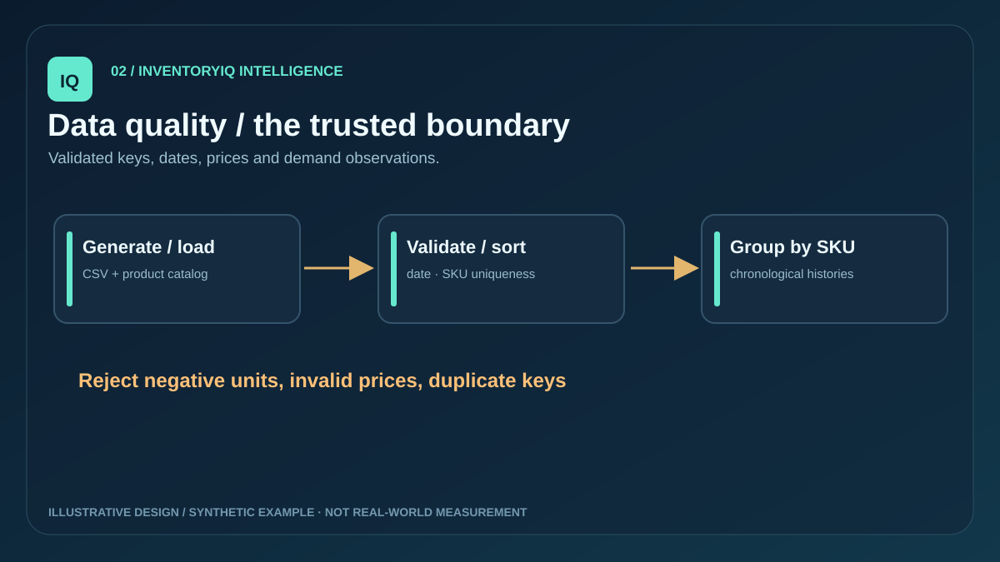
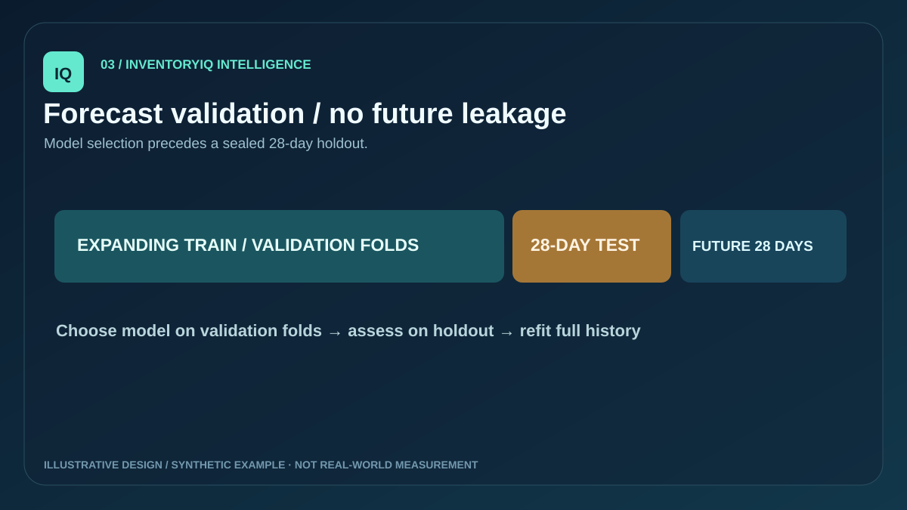
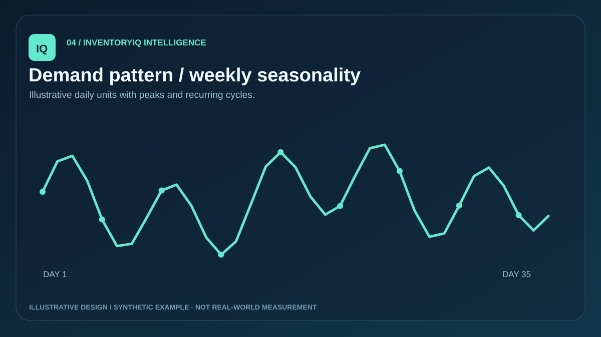
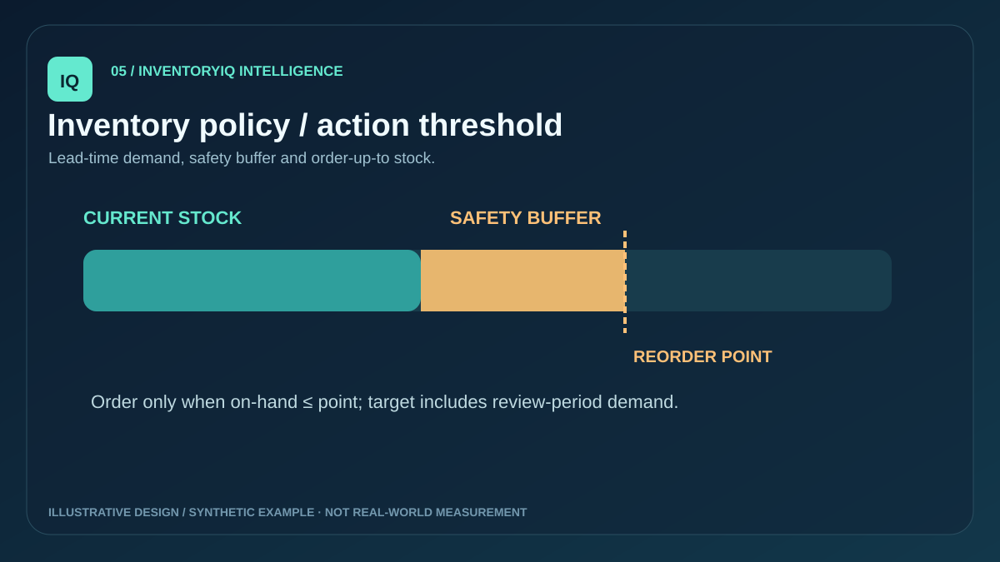
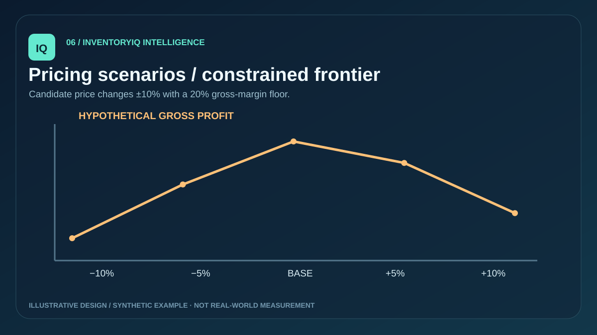
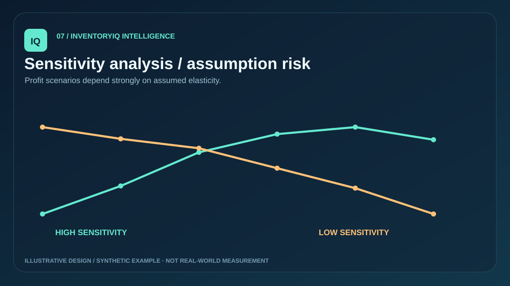
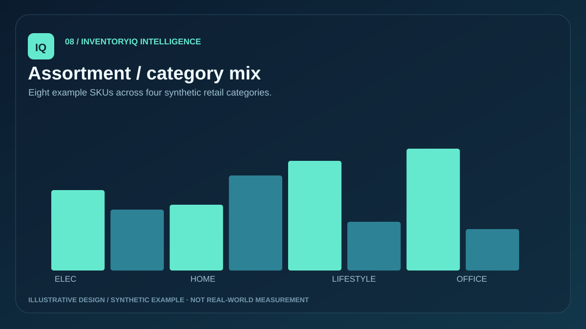
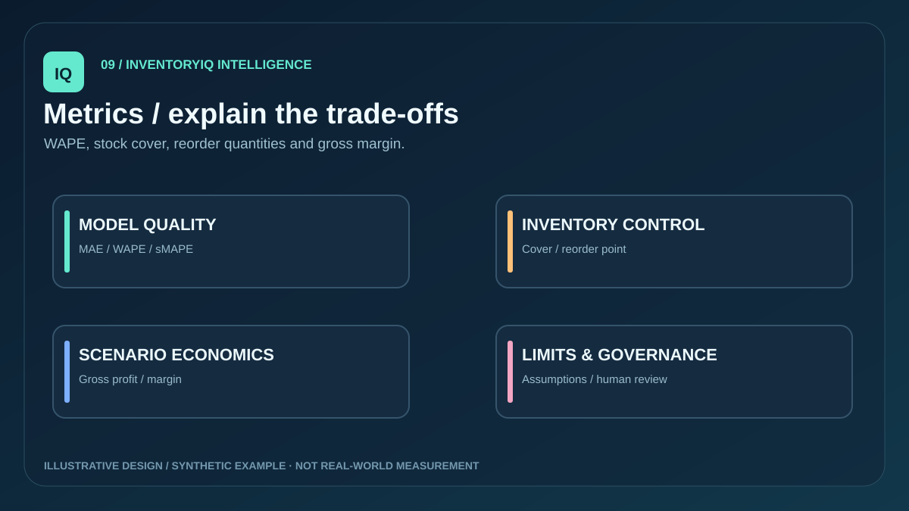
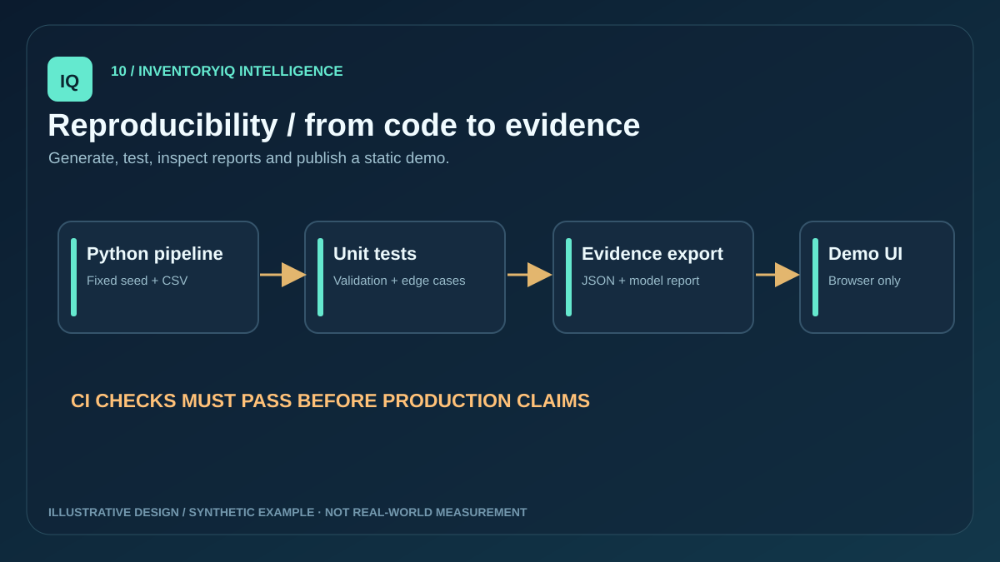

# InventoryIQ — Predictive Inventory & Dynamic Pricing

**An end-to-end, reproducible synthetic retail intelligence portfolio project.** Forecast SKU demand, evaluate models chronologically, calculate reorder quantities and explore constrained pricing scenarios through FastAPI and an interactive browser dashboard.


> **Demo notice:** The dataset, stock, prices and forecast performance are all synthetic or simulated. Pricing elasticity is an assumption, not a causally estimated effect. The dashboard is an independent illustrative browser demo, not a live backend deployment.

## Start here

| Resource | Link |
|---|---|
| Browser dashboard | [Interactive demo source](frontend/index.html) · [GitHub Pages entry point](demo.html) |
| API | [FastAPI implementation](backend/app/main.py) |
| Pipeline | [Full runner](scripts/run_pipeline.py) |
| Model evidence | [Model card](docs/MODEL_CARD.md) |
| Technical architecture | [Pipeline diagram and contracts](docs/ARCHITECTURE.md) |
| Data dictionary | [Fields and assumptions](docs/DATA_DICTIONARY.md) |
| BI guide | [Power BI instructions](powerbi/README.md) |
| Portfolio explanation | [Recruiter case study](docs/PORTFOLIO_CASE_STUDY.md) |

## Features

- Fixed-seed, repeatable daily sales history for eight products across four categories.
- Input schema validation and duplicate-date/SKU rejection.
- Seasonal naïve and weighted-weekday demand forecasting, four expanding-window validation folds, untouched final 28-day test, MAE/WAPE/sMAPE reporting.
- Forecast-driven lead-time demand, safety stock, reorder point, target stock, recommended quantity and indicative stock-cover risk.
- Assumption-based price scenario simulations (−10/−5/0/+5/+10%), 20% gross margin floor and manual-only candidate review.
- Read-only FastAPI with bounded query parameters and local CORS restrictions.
- Responsive, dependency-free static dashboard with editable product, on-hand units and elasticity sliders.
- Tests, CI configuration, architecture/model/data documentation and ten original vector figures.

## Quick start (Python 3.11+)

```bash
git clone https://github.com/harshakavali81-collab/Predictive-Inventory-Dynamic-Pricing.git
cd Predictive-Inventory-Dynamic-Pricing
python -m venv .venv
# Windows PowerShell: .venv\\Scripts\\Activate.ps1
# macOS/Linux: source .venv/bin/activate
pip install -r requirements.txt
python -m unittest discover -s tests -v
python -m scripts.run_pipeline
uvicorn backend.app.main:app --reload
```

Open `http://127.0.0.1:8000/docs` for the API. For the standalone frontend, open `frontend/index.html` directly or run `python -m http.server 8080` at the repo root and open `http://localhost:8080/demo.html`.

Generated outputs: `data/generated/synthetic_sales.csv`, `data/generated/report.json` and `frontend/report.json`. These are ignored from version control and can be recreated by the runner.

## Project tree

```text
inventory-demand-pricing/
├── .github/workflows/ci.yml             # CI tests
├── backend/app/main.py                  # FastAPI endpoints
├── data/generated/                      # synthetic CSV, generated JSON (gitignored)
├── docs/
│   ├── visuals/                         # 10 original SVG figures
│   ├── ARCHITECTURE.md
│   ├── MODEL_CARD.md
│   ├── DATA_DICTIONARY.md
│   ├── RUNBOOK.md
│   └── PORTFOLIO_CASE_STUDY.md
├── frontend/
│   ├── index.html                       # interactive offline demo
│   ├── app.js
│   └── style.css
├── notebooks/                           # EDA, seasonality, model comparison
├── powerbi/README.md                    # Power BI import + DAX guide
├── scripts/run_pipeline.py
├── src/
│   ├── ingestion/generate.py
│   ├── processing/validation.py
│   ├── forecasting/forecast.py
│   ├── inventory/replenishment.py
│   ├── pricing/scenarios.py
│   ├── analytics/report.py
│   └── pipeline.py
├── tests/
│   ├── test_pipeline.py
│   └── test_api.py
├── demo.html
├── requirements.txt
└── README.md
```

## Workflow


## Illustrations (10 original SVG figures)

| | | |
|---|---|---|
|  |  |  |
|  |  |  |
|  |  |  |
|  | | |

Figures are original explanatory SVGs with illustrative patterns, **not captured results from executed experiments**. For numerical reports, run the actual Python pipeline.

## Verified synthetic results

GitHub Actions completed **18 passing Python/API tests** and generated **3,360 deterministic synthetic rows across 8 SKUs**. On the final 28-day holdout, the selected-model WAPE ranged from **10.006% to 20.296%** across the eight synthetic products. These are illustrative model-validation results, **not evidence of real-store accuracy**. See [all eight verified SKU results](docs/VERIFIED_RESULTS.md) and [the CI run](https://github.com/harshakavali81-collab/Predictive-Inventory-Dynamic-Pricing/actions/runs/40654347916).

## Model & business interpretation

`src/forecasting/forecast.py` selects the lower-MAE forecast on four growing-window folds and then reports selected-model and seasonal-baseline errors on the untouched final 28-day test. WAPE is undefined when the actual holdout total is zero; that value is returned as `null`, rather than fabricated. Once evaluated, it forecasts 28 future days using the complete history.

Stock decisions are heuristics based on a fixed 95% service target and historical sales variation. Reorder point = lead-time forecast demand + illustrative safety stock. Order quantity = maximum of zero and target stock minus on-hand, **only if on-hand is at or below reorder point**.

Pricing explores a constant-elasticity relation to reference forecast units. Projected gross profit is before shipping, taxes, fixed costs and returns. The "best" candidate is only best under the chosen assumptions. No prices are changed or sent to an external service.

## Reproducibility and quality

```bash
python -m unittest discover -s tests -v
python -m scripts.run_pipeline
node --check frontend/app.js
```

See [runbook](docs/RUNBOOK.md) for API examples and how to import CSV into Power BI. The notebook examples work with optional `pandas`, `matplotlib` and `jupyter` packages if installed separately.

## Deployment status

- Source code and independent static browser demo: included in this repository.
- GitHub Pages: **requires the repository owner to enable Pages** (Settings → Pages → Deploy from branch → `main` / `/ (root)`). Then the example URL would be `https://harshakavali81-collab.github.io/Predictive-Inventory-Dynamic-Pricing/demo.html` — check it before sharing.
- FastAPI: local only by default; no production cloud backend configured.
- Real POS/ERP stock, sales, experiment-based elasticity, native `.pbix`, production authentication and external validation: **not implemented or verified**.

## Author

[Kavali Harshavardhan](https://github.com/harshakavali81-collab) · [Professional portfolio](https://harshakavali81-collab.github.io/harshavardhan-portfolio/) · Portfolio prototype for data analyst / data scientist / ML engineering interviews.
