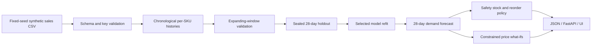
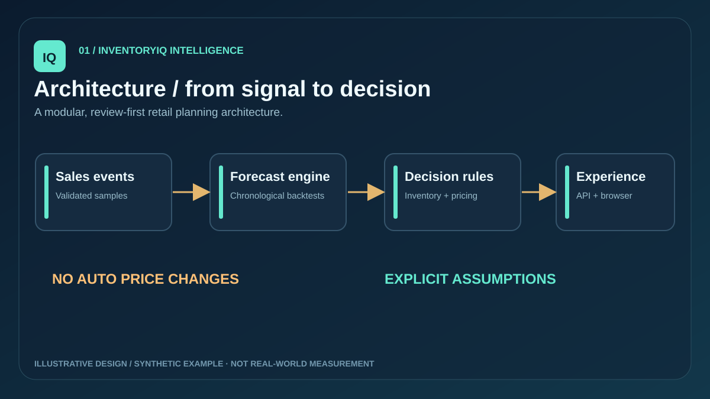

# Architecture and data lineage

InventoryIQ is a **read-only synthetic demonstration**, not integrated into a production ERP/POS.

## Contracts

- Unique grain: one date + SKU per sales row.
- Required fields: `date,sku,category,units,price,promotion,unit_cost`.
- Source generator: `src/ingestion/generate.py`; default 420 daily periods and eight catalog products.
- Validation: reject invalid dates, missing fields, duplicate keys, negative units, nonpositive prices or costs, invalid promotion flags.
- Backtesting: select the forecast method using four expanding folds on data preceding the last 28 days; then report sealed 28-day holdout errors for selected and baseline methods.
- Demand features: time ordering and same-weekday seasonal repeats. The exploratory promotion variable exists in the synthetic dataset but is intentionally **not** used for future demand prediction without a future promotion plan.
- Inventory: demand mean from future forecast; historical variability proxy; safety stock ≈ 1.645 × daily-unit standard deviation × sqrt(lead days); replenishment triggered only below reorder point.
- Pricing: five reference-price candidates at −10%, −5%, 0%, +5%, +10%; guardrails limit change and impose ≥20% modeled gross margin. Units vary under an *assumed* constant price elasticity.
- API: read-only HTTP GET routes, strict bounded query parameters, limited local CORS origins; in-memory report cache.
- Frontend: standalone independent synthetic illustration for portfolio browsing. It does not fetch, train or validate the Python model. Do not mistake its numbers for backtest output.

## Boundaries

Sales data and catalog are synthetic. The service-level value is a target input, not a verified achieved fill rate. Gross profit excludes marketing, shipping, taxes, returns and fixed costs. A causal pricing experiment, fairness review, elasticity calibration, forecasting monitoring, authentication, authorization and operational integration would be needed before real-world price updates.

